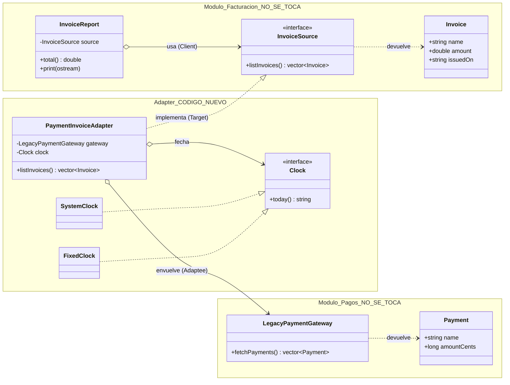

# Diagrama de clases

Las clases de los módulos **no se modifican**; sólo el bloque *Adapter* es código nuevo.
Las firmas están en notación C++; la versión Python es equivalente (`snake_case`, `list`).

## Qué traduce el adapter

| Pagos (Adaptee)            | Facturación (Target)        | Traducción                          |
| :------------------------- | :-------------------------- | :---------------------------------- |
| `amountCents` (entero)     | `amount` (decimal, unidades) | `centavos / 100`                    |
| *(sin fecha)*              | `issuedOn` obligatoria      | se toma de un `Clock` inyectable    |
| reembolsos (monto `<= 0`)  | no existen                  | se omiten                           |
